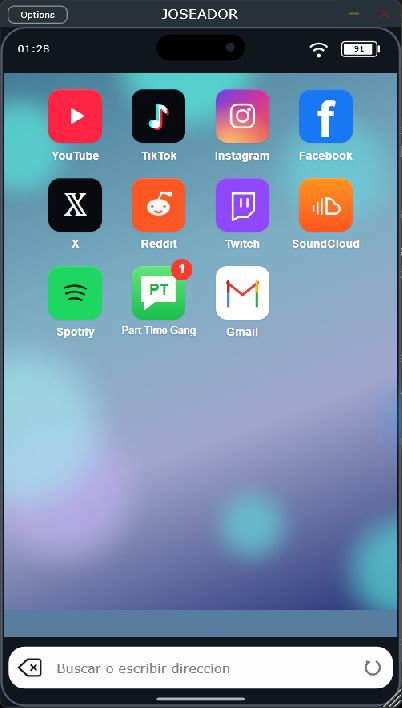

# JOSEADOR 0.4.0

**Por PAPIELGUAPO.** Instrumento VST3 para Windows 11 x64: navegador móvil reescalable, audio al DAW y chat de la comunidad.

[**Descargar ZIP con instalador EXE**](https://github.com/papielguapo/Joseador/releases/latest) · [**Guía**](docs/GUIA.md) · [**Auditoría y correcciones**](docs/AUDITORIA-0.4.0.md)

*Interfaz real de 0.4.0, capturada en la aplicación de escritorio que comparte el editor del VST3.*

## Instalar

1. Descarga y **extrae el ZIP completo**.
2. Cierra el DAW y abre **Instalar JOSEADOR.exe**. Pulsa Instalar.
3. Se copian JOSEADOR.vst3 y BrowserRuntime para tu usuario, con respaldo de la versión anterior. Si falta Visual C++, se abre el instalador oficial de Microsoft incluido en Prerequisites; completa sus instrucciones.
4. En FL Studio, añade la ruta **%LOCALAPPDATA%\Programs\Common\VST3** al gestor de plugins si falta y vuelve a escanear. Carga **JOSEADOR**, fabricante **PAPIELGUAPO**, como instrumento del Channel Rack.

El EXE necesita los archivos del ZIP junto a él: conserva las carpetas JOSEADOR.vst3 y Prerequisites hasta terminar. También se incluye install.ps1 como alternativa para equipos con el runtime ya instalado. Consulta la guía para la instalación manual.

## Navegar y grabar

Inicio contiene YouTube, TikTok, Instagram, Facebook, X, Reddit, Twitch, SoundCloud, Spotify, **Part Time Gang** y Gmail. Se ha retirado el acceso a WhatsApp.

El buscador inferior abre direcciones o búsquedas con Enter. El botón izquierdo retrocede hasta Inicio y el derecho **actualiza la página**. La rueda y las flechas envían gestos a las webs; los campos editables mantienen sus teclas normales. El resultado depende de cada servicio.

El audio sale siempre al DAW, sin una segunda reproducción local de Windows. Asigna el instrumento a una pista del Mixer y graba con Edison o con la grabación de pistas. Las notas MIDI no disparan ni afinan la web. Cerrar el editor no detiene la reproducción mientras el instrumento siga cargado y el host lo procese. No hay grabador WAV interno, selector de escritorio o renderizado acelerado sin conexión.

PCM estéreo de 32 bits float, con calidad limitada por el contenido original. La reproducción es en directo y puede tener latencia. Ventana de 320 × 400 a 1200 × 1400; marco inspirado en un teléfono, sin emular iOS ni Safari. Hora, red y batería proceden del PC.

## Part Time Gang

Abre el icono de Mensajes con **PT** para entrar en la [sala compartida](https://part-time-gang.tangycondor.chatgpt.site). Elige un apodo: aparece junto a tus mensajes, también en los propios. Cambiar apodo permite modificarlo para los mensajes siguientes.

El círculo rojo muestra mensajes sin leer de **1 a 99**; aunque haya más, sigue mostrando **99**, sin signo +. Al abrir y leer el chat se actualiza el contador; a cero se oculta. El estado de lectura se conserva por perfil del plugin.

Es una sala pública con apodos no verificados y hasta 5.000 mensajes guardados. No exige correo ni contraseña. La conexión se actualiza por sondeo; no es un sistema de identidad verificada ni incluye moderación administrativa. La navegación al chat sustituye la página web que estuviera abierta. El servidor y su base de datos están alojados mediante Sites; su código está en [ChatServer](ChatServer).

## Sesiones y contraseñas

Los perfiles se conservan en **%LOCALAPPDATA%\WebCaptureMobile\Profiles\SlotN**. Cada instancia simultánea usa el primer perfil libre. Al cambiar el orden de carga puede cambiar el perfil asignado; no hay una asociación fija por proyecto.

Cookies y almacenamiento web persisten sujetos a caducidad del servicio. En formularios HTTPS compatibles puedes guardar una contraseña en el Administrador de credenciales de Windows, con un usuario por origen. Las peticiones deben coincidir con la web principal. Elimina las entradas WebCaptureMobile:https://... en las credenciales genéricas de Windows para olvidarlas. QR, passkeys y formularios especiales dependen de cada web.

## Compatibilidad y pruebas

Instrumento/MIDI/estado comprobados a 44,1/48/96 kHz. Pruebas de CEF para audio sin salida duplicada, recarga, historial y vista pequeña; seis suites CTest, regresiones de sesión y estado abierto, 26 comprobaciones del chat y contador 0/1/99/100/1000. La apertura de PT y el paso de contador 1 a 0 se verificaron dentro del editor compartido.

No está certificado con todos los DAWs o cuentas reales de cada plataforma. Pro Tools no carga VST3 directamente. No soporta macOS, Linux ni hosts de 32 bits. **Reinicia FL Studio tras actualizar**: el VST3 y su helper deben pertenecer a la misma versión.

## Compilar y licencias

Ejecuta build.ps1 con Visual Studio C++ x64, CMake y Windows 11 SDK. Genera una carpeta package con el VST3, instalador EXE y runtime oficial. JUCE 8.0.6 y CEF 150.0.10 con H.264/AAC se descargan con versiones fijadas. Los nombres internos WebCapture conservan compatibilidad de estado y perfiles.

Código propio MIT. JUCE mantiene licencia AGPLv3/comercial; CEF, Microsoft y las demás dependencias conservan sus licencias. Consulta ThirdParty y [VALIDACION.md](VALIDACION.md). El instalador propio no está firmado digitalmente; el redistribuible de Microsoft conserva su firma original, verificada. Los binarios están en Releases y no se almacenan en Git.
