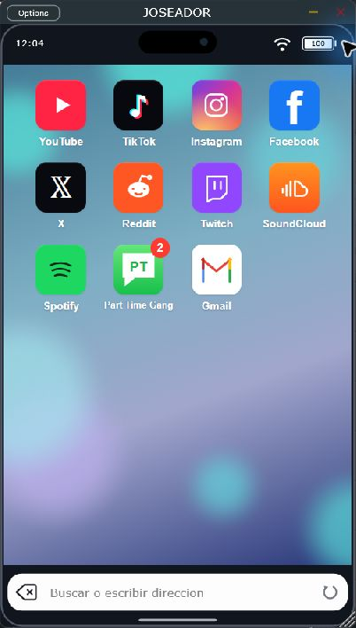

# Guía de JOSEADOR

**Por PAPIELGUAPO · Windows 11 x64 · VST3 · Versión 0.4.3**

JOSEADOR abre páginas web en una ventana móvil y entrega su audio al DAW. En FL Studio se carga como instrumento en el Channel Rack.

*Captura real de 0.4.2: icono PT, contador de mensajes y botón Actualizar página. La aplicación de escritorio comparte el editor del VST3.*

## 1. Descargar e instalar

1. Abre [Releases](https://github.com/papielguapo/Joseador/releases/latest) y descarga el ZIP de Windows 11 VST3.
2. **Extrae todo el ZIP**. Cierra FL Studio u otro DAW.
3. Ejecuta **Instalar JOSEADOR.exe**, acepta el permiso de administrador de Windows y pulsa **Instalar**. Conserva junto al EXE las carpetas JOSEADOR.vst3 y Prerequisites.
4. Si falta Visual C++, se abrirá el instalador oficial de Microsoft incluido. Completa sus instrucciones; Windows puede pedir permisos para ese componente. Si solicita reiniciar, hazlo antes de usar el plugin.
5. Se instala JOSEADOR 0.4.3 completo en **C:\Program Files\Common Files\VST3\JOSEADOR.vst3**. No necesita ni instala una versión anterior. Si ya existe una copia en ese destino, se respalda en **%PROGRAMDATA%\JOSEADOR\PreviousVersions** antes de sustituirla.

El destino es compartido por todos los usuarios y requiere permisos de administrador. En Windows instalado en otra unidad se utiliza su carpeta Common Files x64. BrowserRuntime debe permanecer dentro del paquete. El instalador valida sus archivos y revierte una sustitución fallida cuando es posible. No abre ni cierra tu DAW por ti.

Para instalación manual, copia la carpeta JOSEADOR.vst3 completa al destino anterior y asegúrate de disponer del runtime de Microsoft. install.ps1 sigue disponible como alternativa ejecutándolo desde PowerShell como administrador. El EXE propio no tiene firma digital; el runtime de Microsoft sí conserva su firma original.

## 2. Encontrarlo en FL Studio

1. Abre **Options > Manage plugins**; según la versión, también se accede desde **Options > File settings > Manage plugins**.
2. Comprueba que la carpeta `C:\Program Files\Common Files\VST3` figure entre las rutas de búsqueda. Añádela si falta.
3. Ejecuta **Find installed plugins** con **Verify plugins** para que se clasifique como instrumento.
4. Si sigue apareciendo el nombre antiguo, activa **Rescan previously verified plugins** y repite el escaneo.
5. En el Channel Rack, abre **+ > More plugins…**, busca **JOSEADOR** y cárgalo. El fabricante debe ser **PAPIELGUAPO**.

Si instalaste 0.4.0 en `%LOCALAPPDATA%\Programs\Common\VST3`, mueve esa copia anterior de JOSEADOR.vst3 fuera de las rutas de plugins con el DAW cerrado para evitar duplicados. El instalador nuevo no depende de ella ni utiliza sus archivos; las sesiones web permanecen en el perfil de usuario.

Puedes marcarlo como favorito para encontrarlo después en el selector. Estos pasos siguen el [manual de instalación de plugins de Image-Line](https://www.image-line.com/fl-studio-learning/fl-studio-online-manual/html/basics_externalplugins.htm).

## Sin conexión

Si Windows informa de que no hay acceso a Internet, el navegador deja paso al mensaje «Se requiere conexión a internet para usar este VST» y a la imagen suministrada. La imagen está integrada en el plugin. Al recuperar Internet, la pantalla se retira y se vuelve a cargar Inicio, una sola vez por reconexión. La comprobación se realiza aproximadamente cada dos segundos, sin cambiar ajustes de red.

## 3. Abrir una web

Para volver a Inicio desde el buscador, escribe **inicio** y pulsa Enter, o deja el campo vacío y pulsa Enter. No distingue mayúsculas y omite espacios alrededor.

Pulsa cualquiera de los once iconos: YouTube, TikTok, Instagram, Facebook, X, Reddit, Twitch, SoundCloud, Spotify, Part Time Gang o Gmail. Gmail abre su web y Part Time Gang abre la sala compartida.

También puedes escribir una dirección o una búsqueda en la barra inferior y pulsar **Enter**. El botón izquierdo retrocede por el historial hasta llegar a Inicio; allí permanece. El botón circular **Actualizar página**, a la derecha, recarga la web abierta. Para sustituir texto, selecciónalo en el buscador y escribe la nueva dirección.

Arrastra la esquina de la ventana para cambiar su tamaño. La vista móvil y la pantalla de Inicio se adaptan al espacio disponible.

## 4. Rueda y teclado

Haz clic en el contenido de la página para darle el foco antes de usar las flechas.

| Control | Acción enviada a la web |
| --- | --- |
| Rueda hacia abajo / arriba | Deslizamiento vertical en el sentido correspondiente |
| ↓ / ↑ | Gesto vertical, como deslizar el dedo |
| → / ← | Gesto horizontal |
| Rueda o flechas en historias compatibles | Avanzar o retroceder |

TikTok, Reels y Shorts reciben gestos para cambiar de vídeo. SoundCloud, Spotify y las otras webs reciben desplazamientos táctiles. El efecto concreto depende de los controles de cada página: una flecha horizontal no garantiza cambiar de canción. Al escribir en un campo, las flechas mantienen su función de edición. Hay una breve pausa entre gestos para evitar saltos accidentales.

## 5. Grabar el audio con Edison

1. Asigna el canal de JOSEADOR a una pista del Mixer, por ejemplo **Insert 1**, y comprueba que su medidor reacciona al reproducir una web.
2. Carga **Edison** en una ranura de efectos de esa misma pista.
3. En Edison, selecciona el modo de inicio **Now** y activa **Record** para grabar sin depender del transporte de FL.
4. Reproduce el contenido en JOSEADOR y observa la forma de onda que recibe Edison.
5. Desactiva **Record** para terminar. Guarda la grabación o usa **Send sample to Playlist** para llevarla al proyecto.

Edison graba en la posición de su ranura: colócalo antes o después de otros efectos según quieras capturarlos. Consulta las [opciones de grabación de Edison](https://www.image-line.com/fl-studio-learning/fl-studio-online-manual/html/plugins/Edison_2.htm). Para guardar sin compresión con pérdida, usa WAV; el [manual de Edison](https://www.image-line.com/fl-studio-learning/fl-studio-online-manual/html/plugins/Edison_3.htm) explica los formatos y la resolución de 32 bits float.

La salida al DAW está siempre activa y no necesita notas MIDI. JOSEADOR no tiene grabador WAV interno. Cerrar su editor no detiene la reproducción: pausa el contenido en la web cuando termines. Su salida local adicional de Windows está desactivada; evita reproducir el mismo contenido a la vez en otro navegador o en otra instancia si escuchas duplicación.

## 6. Sesiones y contraseñas

Las cookies y el almacenamiento de las webs se conservan entre aperturas. En formularios HTTPS compatibles, puedes aceptar la pregunta de JOSEADOR para guardar una contraseña en el Administrador de credenciales de Windows. Se almacena un usuario por origen web.

Las instancias simultáneas usan perfiles separados. Si cambia su orden de apertura puede cambiar el perfil que recibe cada una. Una web también puede pedir iniciar sesión otra vez por caducidad o por sus controles de seguridad. QR, passkeys y formularios especiales dependen del servicio.

## 7. Resolver problemas

| Problema | Qué comprobar |
| --- | --- |
| No aparece JOSEADOR | Ruta de búsqueda, escaneo y opción de volver a verificar plugins |
| Aparece WebCapture Mobile | Reescanea los plugins verificados y vuelve a cargar el instrumento |
| No abre el navegador | Que BrowserRuntime esté junto al binario, dentro del paquete VST3 |
| No llega audio al Mixer | Reproducción y volumen de la web, canal asignado, mute y procesamiento del host |
| Las flechas controlan FL | Haz clic en el contenido de la web para enfocarlo |
| Una web no cambia de vídeo o no permite entrar | Sus controles o autenticación pueden no admitir el navegador integrado |

El audio se entrega en estéreo de 32 bits float, con calidad limitada por la fuente original. La reproducción es en directo, puede tener latencia y no está sincronizada con el transporte del DAW. Usa grabación en tiempo real. Consulta [las comprobaciones realizadas](../VALIDACION.md) para conocer el alcance de compatibilidad.

[Volver a la portada](../README.md) · [Descargar JOSEADOR](https://github.com/papielguapo/JOSEADOR/releases/latest)

[Auditoría interna de 0.3.1](AUDITORIA.md): correcciones, pruebas y límites de esta revisión.

## Part Time Gang: apodos y mensajes

Abre el icono verde de Mensajes con PT. Introduce un apodo de 1 a 24 caracteres y pulsa Entrar. Ese nombre aparece en tus mensajes. Cambiar apodo permite elegir otro para los siguientes envíos. Enter envía y Mayús+Enter añade una línea.

El círculo rojo de Inicio cuenta mensajes sin leer: de 1 a 99; por encima de 99 sigue mostrando 99. Se oculta cuando no quedan mensajes sin leer. El contador se actualiza al abrir y leer la sala, y se conserva por perfil. La sala es pública y los apodos no verifican la identidad. Se guardan los últimos 5.000 mensajes. Al llegar al límite, cada mensaje nuevo elimina automáticamente el más antiguo; el chat continúa funcionando sin reiniciarlo.

[Abre la sala](https://part-time-gang.tangycondor.chatgpt.site). Cambiar a esta página puede detener el contenido web anterior; las otras pistas del DAW siguen funcionando.

[Auditoría y correcciones de 0.4.2](AUDITORIA-0.4.2.md).

[Corrección de scroll de 0.4.3](CORRECCION-SCROLL-0.4.3.md).
