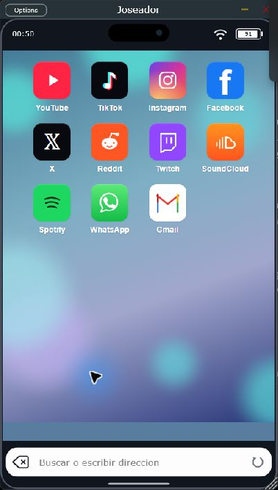

# Guía de Joseador

**Por PAPIELGUAPO · Windows 11 x64 · VST3 · Versión 0.3.1**

Joseador abre páginas web en una ventana móvil y entrega su audio al DAW. En FL Studio se carga como instrumento en el Channel Rack.



*Captura real de 0.3.1, con Actualizar página a la derecha del buscador. La aplicación de escritorio comparte el editor del VST3.*

## 1. Descargar e instalar

1. Abre [la página de descargas](https://github.com/papielguapo/Joseador/releases/latest).
2. En **Assets**, descarga el ZIP de Windows 11 VST3 (no el archivo Source code) y extrae todo su contenido.
3. Cierra FL Studio y ejecuta **install.ps1** con PowerShell.
4. El instalador copia el paquete completo a:

   ```text
   %LOCALAPPDATA%\Programs\Common\VST3\Joseador.vst3
   ```

Conserva **BrowserRuntime** dentro del paquete: contiene el motor que abre las webs. No basta con copiar el archivo binario interior.

Si no puedes ejecutar el script, crea la carpeta de destino indicada y copia allí la carpeta completa **Joseador.vst3**. Si conservas una instalación de **WebCapture Mobile**, muévela primero a una carpeta de respaldo fuera de las rutas de plugins; ambos nombres comparten identificador. El instalador realiza ese respaldo automáticamente.

## 2. Encontrarlo en FL Studio

1. Abre **Options > Manage plugins**; según la versión, también se accede desde **Options > File settings > Manage plugins**.
2. Comprueba que la carpeta `%LOCALAPPDATA%\Programs\Common\VST3` figure entre las rutas de búsqueda. Añádela si falta.
3. Ejecuta **Find installed plugins** con **Verify plugins** para que se clasifique como instrumento.
4. Si sigue apareciendo el nombre antiguo, activa **Rescan previously verified plugins** y repite el escaneo.
5. En el Channel Rack, abre **+ > More plugins…**, busca **Joseador** y cárgalo. El fabricante debe ser **PAPIELGUAPO**.

Puedes marcarlo como favorito para encontrarlo después en el selector. Estos pasos siguen el [manual de instalación de plugins de Image-Line](https://www.image-line.com/fl-studio-learning/fl-studio-online-manual/html/basics_externalplugins.htm).

## 3. Abrir una web

Pulsa cualquiera de los once iconos: YouTube, TikTok, Instagram, Facebook, X, Reddit, Twitch, SoundCloud, Spotify, WhatsApp o Gmail. Los accesos de WhatsApp y Gmail abren sus webs dentro del navegador.

También puedes escribir una dirección o una búsqueda en la barra inferior y pulsar **Enter**. El botón izquierdo retrocede por el historial hasta llegar a Inicio; allí permanece. El botón circular **Actualizar página**, a la derecha, recarga la web abierta. Para sustituir texto, selecciónalo en el buscador y escribe la nueva dirección.

Arrastra la esquina de la ventana para cambiar su tamaño. La vista móvil y la pantalla de Inicio se adaptan al espacio disponible.

## 4. Rueda y teclado

Haz clic en el contenido de la página para darle el foco antes de usar las flechas.

| Control | Acción enviada a la web |
| --- | --- |
| Rueda hacia abajo / arriba | Deslizamiento vertical en el sentido correspondiente |
| ↓ / ↑ | Gesto vertical, como deslizar el dedo |
| → / ← | Gesto horizontal |
| Rueda o flechas en historias compatibles | Avanzar o retroceder |

TikTok, Reels y Shorts reciben gestos para cambiar de vídeo. SoundCloud, Spotify y las otras webs reciben desplazamientos táctiles. El efecto concreto depende de los controles de cada página: una flecha horizontal no garantiza cambiar de canción. Al escribir en un campo, las flechas mantienen su función de edición. Hay una breve pausa entre gestos para evitar saltos accidentales.

## 5. Grabar el audio con Edison

1. Asigna el canal de Joseador a una pista del Mixer, por ejemplo **Insert 1**, y comprueba que su medidor reacciona al reproducir una web.
2. Carga **Edison** en una ranura de efectos de esa misma pista.
3. En Edison, selecciona el modo de inicio **Now** y activa **Record** para grabar sin depender del transporte de FL.
4. Reproduce el contenido en Joseador y observa la forma de onda que recibe Edison.
5. Desactiva **Record** para terminar. Guarda la grabación o usa **Send sample to Playlist** para llevarla al proyecto.

Edison graba en la posición de su ranura: colócalo antes o después de otros efectos según quieras capturarlos. Consulta las [opciones de grabación de Edison](https://www.image-line.com/fl-studio-learning/fl-studio-online-manual/html/plugins/Edison_2.htm). Para guardar sin compresión con pérdida, usa WAV; el [manual de Edison](https://www.image-line.com/fl-studio-learning/fl-studio-online-manual/html/plugins/Edison_3.htm) explica los formatos y la resolución de 32 bits float.

La salida al DAW está siempre activa y no necesita notas MIDI. Joseador no tiene grabador WAV interno. Cerrar su editor no detiene la reproducción: pausa el contenido en la web cuando termines. Su salida local adicional de Windows está desactivada; evita reproducir el mismo contenido a la vez en otro navegador o en otra instancia si escuchas duplicación.

## 6. Sesiones y contraseñas

Las cookies y el almacenamiento de las webs se conservan entre aperturas. En formularios HTTPS compatibles, puedes aceptar la pregunta de Joseador para guardar una contraseña en el Administrador de credenciales de Windows. Se almacena un usuario por origen web.

Las instancias simultáneas usan perfiles separados. Si cambia su orden de apertura puede cambiar el perfil que recibe cada una. Una web también puede pedir iniciar sesión otra vez por caducidad o por sus controles de seguridad. QR, passkeys y formularios especiales dependen del servicio.

## 7. Resolver problemas

| Problema | Qué comprobar |
| --- | --- |
| No aparece Joseador | Ruta de búsqueda, escaneo y opción de volver a verificar plugins |
| Aparece WebCapture Mobile | Reescanea los plugins verificados y vuelve a cargar el instrumento |
| No abre el navegador | Que BrowserRuntime esté junto al binario, dentro del paquete VST3 |
| No llega audio al Mixer | Reproducción y volumen de la web, canal asignado, mute y procesamiento del host |
| Las flechas controlan FL | Haz clic en el contenido de la web para enfocarlo |
| Una web no cambia de vídeo o no permite entrar | Sus controles o autenticación pueden no admitir el navegador integrado |

El audio se entrega en estéreo de 32 bits float, con calidad limitada por la fuente original. La reproducción es en directo, puede tener latencia y no está sincronizada con el transporte del DAW. Usa grabación en tiempo real. Consulta [las comprobaciones realizadas](../VALIDACION.md) para conocer el alcance de compatibilidad.

[Volver a la portada](../README.md) · [Descargar Joseador](https://github.com/papielguapo/Joseador/releases/latest)

[Auditoría interna de 0.3.1](AUDITORIA.md): correcciones, pruebas y límites de esta revisión.
